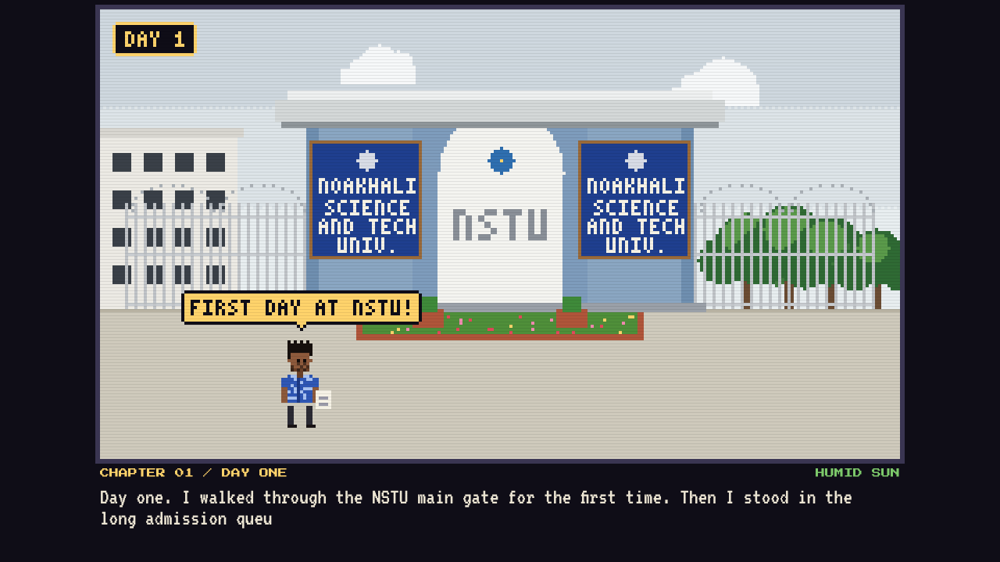
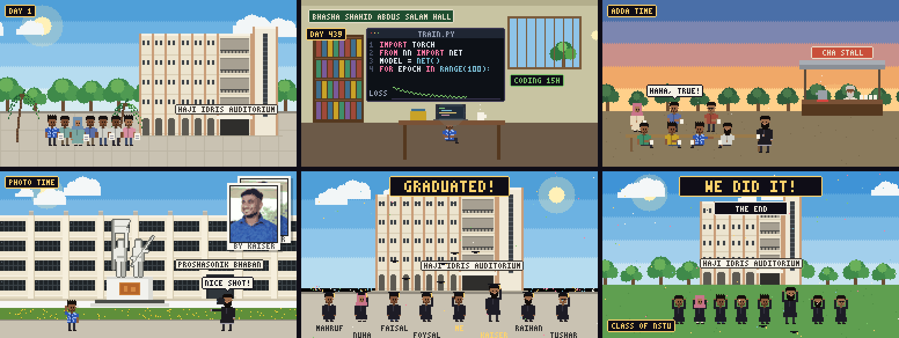

<div align="center">

# My NSTU Journey

**A pixel-art story of my years at Noakhali Science and Technology University.**

From the main gate and the admission queue to 15-hour coding days in Salam Hall,
my BSc research defense, graduation, and one last photo with my friends.



[**Watch the video**](media/My_NSTU_Journey.mp4) · [Run it locally](#run-it-locally) · [Deploy on Vercel](#deploy-on-vercel)


</div>

---

## About

This is my true story, told as a 22-chapter interactive pixel-art film. Every building is drawn from real photos of the NSTU campus in Sonapur, Noakhali, and the people in it are me and the friends who walked this road with me.

It runs in any browser with its own chiptune soundtrack, and it renders to a 3½-minute MP4 video.



## The story

| # | Chapter | What happens |
|---|---------|--------------|
| 0 | Prologue | My NSTU journey, a true story |
| 1 | Day One | Walking through the NSTU main gate, then the admission queue at the Haji Idris Auditorium |
| 2 | First Class | My first class in the Department of Statistics |
| 3 | First Finals | Semester-one finals in a Noakhali monsoon storm |
| 4 | Lost | Frustrated by the campus pond, searching for meaning |
| 5 | Someone | A sunset walk and falling in love |
| 6 | The Turn | Realizing I was wasting time, and deciding to learn AI |
| 7 | Salam Hall | Coding 12 to 15 hours a day, for two years |
| 8 | The Bench | Falling asleep in the Salam Hall reading room |
| 9 | Home Food | Mahruf cooking for me in the hall |
| 10 | Adda | Evening gossip at the cha stall, all eight of us |
| 11 | 2 AM Walks | Walking past the Shaheed Minar at night, talking myself out of quitting |
| 12 | The Results | Grades falling, and never giving up |
| 13 | Kaiser | My best friend, always with his camera |
| 14 | Snapshots | Kaiser shoots me at the Proshasonik Bhaban |
| 15 | The Chance | Working with PhD candidates on their research |
| 16 | Golden Hour | Another photo by the pond at sunset |
| 17 | The Defense | Defending my BSc research project |
| 18 | Graduation | Graduating with all of my friends |
| 19 | Today | Sharing my coding journey |
| 20 | One Last Photo | Kaiser sets the timer for the group photo |
| 21 | Finale | Caps in the sky |

**Cast:** me, Kaiser, Mahruf, Nuha, Faisal, Foysal, Raihan and Tushar.

**Real places:** the NSTU main gate, Haji Idris Auditorium, Proshasonik Bhaban and its Liberation War sculpture, Bhasha Shahid Abdus Salam Hall, the Shaheed Minar, the Central Library, and the Department of Statistics.

## Features

- **Hand-coded pixel art.** Every scene is drawn in code on a 256×144 canvas, scaled up crisp. There are no image sprites, apart from three portraits made from real photos.
- **Original chiptune soundtrack.** Eight moods (hopeful, tense, sad, romantic, chill, driving, night, triumphant) composed with the Web Audio API, pre-rendered to `media/soundtrack.mp3` and played in sync with the scenes, so it sounds clean on phones too (including iPhones with the silent switch on).
- **Sound effects.** Monsoon rain, thunder, heartbeat, keyboard typing, sizzling dim bhuna, tea-stall chatter, crickets, camera shutters and a graduation crowd.
- **Player controls.** Play/pause, speed (1×, 2×, 0.5×), auto-advance, sound on/off, a chapter strip, and keyboard shortcuts.
- **Video export.** One script renders the whole story to a 1280×720 MP4 with stereo sound.
- **No build step.** Plain HTML, CSS and JavaScript. Open it and it works.

## Controls

| Action | How |
|--------|-----|
| Next scene | Tap the picture, **NEXT**, or <kbd>→</kbd> |
| Previous scene | **PREV** or <kbd>←</kbd> |
| Pause / play | **PAUSE** or <kbd>Space</kbd> |
| Change speed | **1X** (cycles 1× → 2× → 0.5×) |
| Auto-advance on/off | **AUTO** |
| Sound on/off | **SOUND ON** |
| Jump to a chapter | The chapter strip under the controls |

## Project structure

```
my-nstu-journey/
├── index.html              Page layout: stage, captions, controls
├── css/
│   └── style.css           Pixel look and dark theme
├── js/                     Loaded in this order:
│   ├── core.js             Canvas, palette, drawing helpers, 3×5 pixel font
│   ├── scenery.js          Sky, weather, trees, and the real NSTU buildings
│   ├── people.js           Character sprites: me, Kaiser and friends
│   ├── scenes.js           Every chapter, plus the SC list (durations and captions)
│   ├── audio.js            Chiptune score and sound effects (live and offline)
│   └── player.js           Controls, chapter strip, captions, video export hooks
├── assets/img/             Pixel portraits (me, Kaiser, the defense photo)
├── media/
│   ├── My_NSTU_Journey.mp4 The rendered video
│   └── soundtrack.mp3      The soundtrack the site plays (synced to the scenes)
├── docs/                   README images
├── tools/
│   └── render_video.py     Renders the story to MP4
├── vercel.json             Static hosting settings
└── LICENSE
```

## Run it locally

Serve the folder with any static web server:

```bash
git clone https://github.com/aziz-ashfak/my-nstu-journey.git
cd my-nstu-journey
python -m http.server 8000
```

Then open <http://localhost:8000>.

> Use a local server rather than double-clicking `index.html`. Browsers block some canvas features on `file://` pages.

## Deploy on Vercel

1. Push this repository to GitHub.
2. On [vercel.com](https://vercel.com), click **Add New → Project** and import `my-nstu-journey`.
3. Set **Framework Preset** to **Other**, and leave the build command and output directory empty.
4. Click **Deploy**.

The site is live in about a minute. Visitors can download the video with the **DOWNLOAD THE VIDEO (MP4)** button. `vercel.json` makes the browser save it as a file instead of playing it.

## Re-render the video

After editing scenes or captions, render a fresh MP4:

```bash
pip install playwright
python -m playwright install chromium
python tools/render_video.py
```

You also need [ffmpeg](https://ffmpeg.org/download.html) on your `PATH`. The script opens the page in a headless browser, records every frame at 30 fps, renders the soundtrack offline, and writes `media/My_NSTU_Journey.mp4` and `media/soundtrack.mp3`. Always re-render after changing scene lengths or sounds, so the website's soundtrack stays in sync.

| Option | Default | What it does |
|--------|---------|--------------|
| `--out` | `media/My_NSTU_Journey.mp4` | Output file |
| `--fps` | `30` | Frames per second |
| `--font-dir` | — | Folder with `vt323.woff2` and `press-start-2p.woff2`, for offline machines |

## Editing the story

| To change… | Edit |
|------------|------|
| Captions, chapter titles, scene length or order | The `SC` list at the end of `js/scenes.js` |
| Music mood and sound effects per scene | The `SA` list in `js/audio.js` (one entry per scene, same order as `SC`) |
| Friends' names, clothes and looks | The `FRIENDS` list in `js/scenes.js` |
| My look, Kaiser's look | `ME` and `KAISER` in `js/people.js` |
| Campus buildings | `nstuGate`, `auditorium`, `adminReal`, `statue`, `salamExt`, `minarReal`, `libraryReal` in `js/scenery.js` |
| Portraits | The PNGs in `assets/img/`: 40×48 for `me.png` and `kaiser.png`, 40×56 for `defense.png` |

**Adding a new scene:**
1. Write a function `sMyScene(t)` in `js/scenes.js`, where `t` is the seconds since the scene started.
2. Add `{d:9, f:sMyScene, ch:'CHAPTER 00 / NAME', tag:'WEATHER', cap:'Caption…'}` to `SC` at the right position.
3. Add a matching sound entry such as `{m:'hope', fx:[['birds',0,40]]}` to `SA` in `js/audio.js` at the same position.

Chapter numbers renumber themselves automatically.

## Built with

- **HTML5 Canvas** for all the drawing
- **Web Audio API** for the music and sound effects
- **[Press Start 2P](https://fonts.google.com/specimen/Press+Start+2P)** and **[VT323](https://fonts.google.com/specimen/VT323)** from Google Fonts
- **Playwright** and **ffmpeg** for the video export

## Acknowledgements

To Kaiser, who was always behind the camera. To Mahruf, Nuha, Faisal, Foysal, Raihan and Tushar, my NSTU family. And to Noakhali Science and Technology University, the Oxford of the Coastal.

*I never gave up, and I was never alone.*

## License

[MIT](LICENSE) © 2026 Aziz Ashfak
